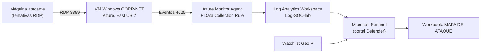

# Laboratório SIEM com Microsoft Sentinel: detecção de tentativas de login RDP

Laboratório prático de Blue Team no Azure. Uma VM Windows exposta de propósito gera eventos de falha de logon (Event ID 4625), que são coletados pelo Azure Monitor Agent, armazenados em um Log Analytics Workspace e analisados no Microsoft Sentinel, com um mapa das tentativas de acesso por localização.

> **Transparência:** as tentativas de login foram geradas por mim, a partir da minha própria máquina, usando contas inexistentes. O objetivo foi montar e entender o pipeline de coleta, análise e visualização, e não capturar ataques reais da internet.

## Objetivos

- Montar um pipeline de logs de ponta a ponta: **VM → agente → workspace → SIEM → visualização**
- Entender a anatomia do evento **4625** e o que cada campo permite concluir
- Enriquecer IPs de origem com geolocalização usando uma watchlist
- Visualizar as tentativas em um workbook com mapa

## Arquitetura



## Ambiente

| Componente | Configuração |
|---|---|
| Nuvem / região | Microsoft Azure, East US 2 |
| Resource group | `RG-SOC-LABE` |
| VM alvo | `CORP-NET` (Windows) |
| Coleta | Conector *Windows Security Events via AMA* + Data Collection Rule |
| Armazenamento | Log Analytics Workspace `Log-SOC-lab` |
| SIEM | Microsoft Sentinel, acessado pelo portal Microsoft Defender |
| Enriquecimento | Watchlist `GeoIP` (CSV, chave de busca `network`) |
| Visualização | Workbook `MAPA DE ATAQUE` |

## Passo a passo

### 1. Infraestrutura no Azure

Resource group com a VM e os recursos associados (IP público, NSG, interface de rede, disco e rede virtual), todos em East US 2.


### 2. Exposição proposital da VM

Para o laboratório, criei no NSG uma regra de entrada de prioridade 100 (`Danger`) que permite qualquer origem, porta e protocolo. Como o NSG avalia as regras por prioridade, ela é aplicada antes da regra padrão `DenyAllInBound` (65500). O firewall do Windows também foi desabilitado dentro da VM.


### 3. Validação de conectividade

Antes de liberar o tráfego, o `ping` para o IP público da VM teve 100% de perda. Depois, 0% de perda, com média de 132 ms.


### 4. Gerando eventos de falha de logon

Tentativa de conexão RDP com o usuário inexistente `empregado`, para produzir eventos 4625.


### 5. Eventos 4625 no Event Viewer da VM

Os eventos aparecem no log **Security** como *Audit Failure*, Task Category *Logon*.


### 6. Anatomia do evento 4625

Campos que mais importam para a análise:

| Campo | O que informa |
|---|---|
| Account Name / Account Domain | Conta que tentou logar (`empregado`) |
| Failure Reason | Mensagem genérica: *Unknown user name or bad password* |
| Status `0xC000006D` | Falha de logon |
| Sub Status `0xC0000064` | O nome de usuário **não existe** (uma senha errada em conta existente apareceria com outro sub status) |
| Workstation Name | Nome da máquina de origem, informado pelo cliente (por isso pode ser forjado) |
| Source Network Address | IP de origem da tentativa |


### 7. Log Analytics Workspace

Workspace `Log-SOC-lab` criado na mesma região da VM.


### 8. Coleta com Azure Monitor Agent e Data Collection Rule

No Sentinel, o conector *Windows Security Events via AMA* cria uma Data Collection Rule associada à VM `CORP-NET`. O Azure Monitor Agent é instalado automaticamente e uma identidade gerenciada atribuída ao sistema é habilitada na máquina.


### 9. Consulta aos eventos coletados

Na tabela `SecurityEvent` do workspace aparecem as tentativas da conta `MicrosoftAccount\Atacante` contra `CORP-NET`: **5 tentativas em cerca de 11 segundos** (21:09:32 a 21:09:43 UTC), junto com eventos normais da conta `NT AUTHORITY\SYSTEM` e da conta administrativa do laboratório.


Consultas de referência (adapte aos nomes de colunas do seu ambiente):

```kql
// Falhas de logon
SecurityEvent
| where EventID == 4625
| project TimeGenerated, Account, Computer, IpAddress, WorkstationName
| order by TimeGenerated desc
```

```kql
// Enriquecimento com a watchlist GeoIP
let GeoIP = _GetWatchlist("geoip");
SecurityEvent
| where EventID == 4625
| evaluate ipv4_lookup(GeoIP, IpAddress, network)
```

### 10. Investigação assistida

O agente integrado ao Log Analytics resumiu os eventos 4625 (conta, computador, horário). Esse tipo de resumo é um ponto de partida: a fonte de verdade continua sendo o evento bruto da etapa anterior.


### 11. Watchlist GeoIP

Watchlist local em CSV, com `network` como chave de busca, usada para associar o IP de origem a uma localização.


### 12. Workbook com mapa

O workbook `MAPA DE ATAQUE` plota as tentativas por localização. Resultado: 5 tentativas, geolocalizadas em Uberlândia (Brazil).


## Limitações

- **Origem única e conhecida:** todas as tentativas partiram da minha máquina, então o mapa mostra um único ponto. Ele valida o pipeline, mas não representa o cenário de ameaças da internet.
- **Geolocalização por IP é aproximada:** o ponto no mapa tende a refletir a infraestrutura do provedor de internet, não o endereço real de quem tentou o acesso.
- **Escala pequena:** 5 eventos servem para validar a coleta, mas não para análise estatística de padrões.

## Aprendizados

- Fluxo completo de telemetria no Azure: VM, AMA, Data Collection Rule, Log Analytics e Sentinel.
- O Sentinel agora é operado pelo portal Microsoft Defender, e o Azure Monitor Agent com DCR substitui o agente legado de logs.
- O evento 4625 diferencia, pelo Sub Status, conta inexistente de senha incorreta, o que muda a leitura de uma tentativa de força bruta ou de enumeração de usuários.
- Campos como `Workstation Name` são informados pelo cliente e não devem ser tratados como prova de identidade.


## Créditos

Laboratório baseado no vídeo 
Cyber Home Lab from ZERO and Catch Attackers! Free, Easy, and REAL (Microsoft Sentinel 2025) do canal Josh Madakor: https://www.youtube.com/watch?v=g5JL2RIbThM
